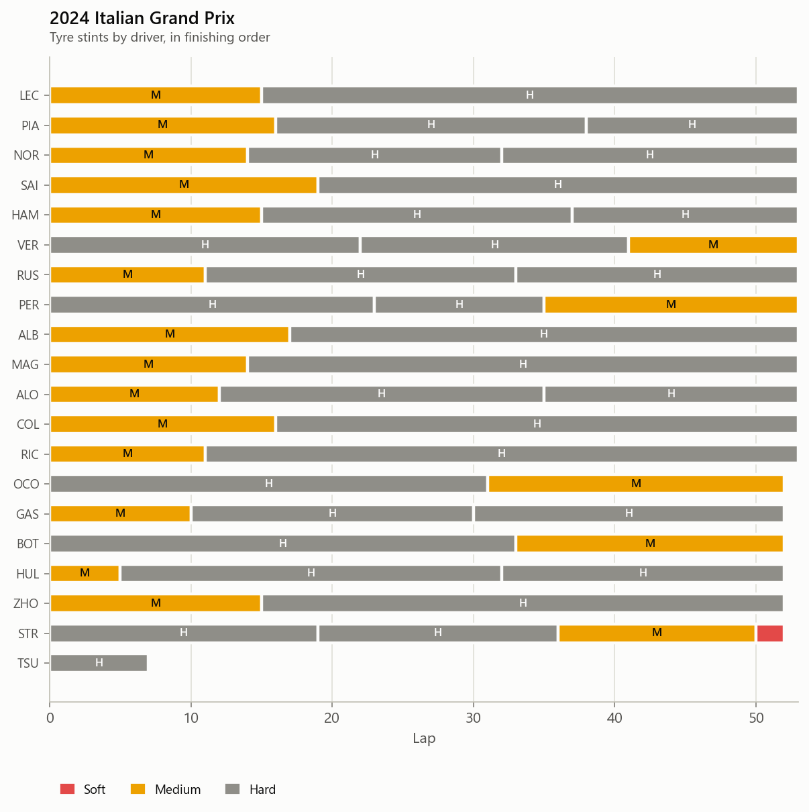
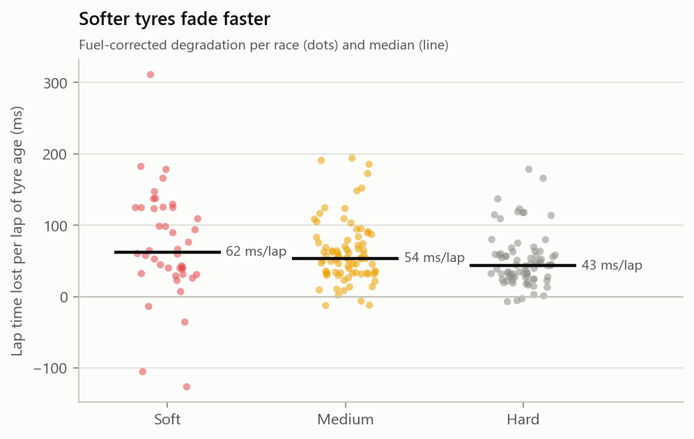
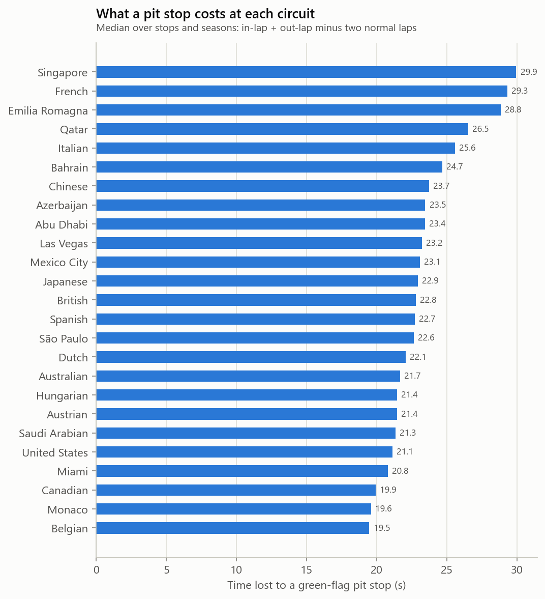
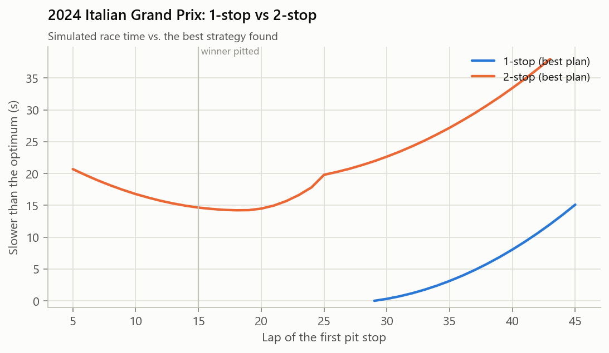
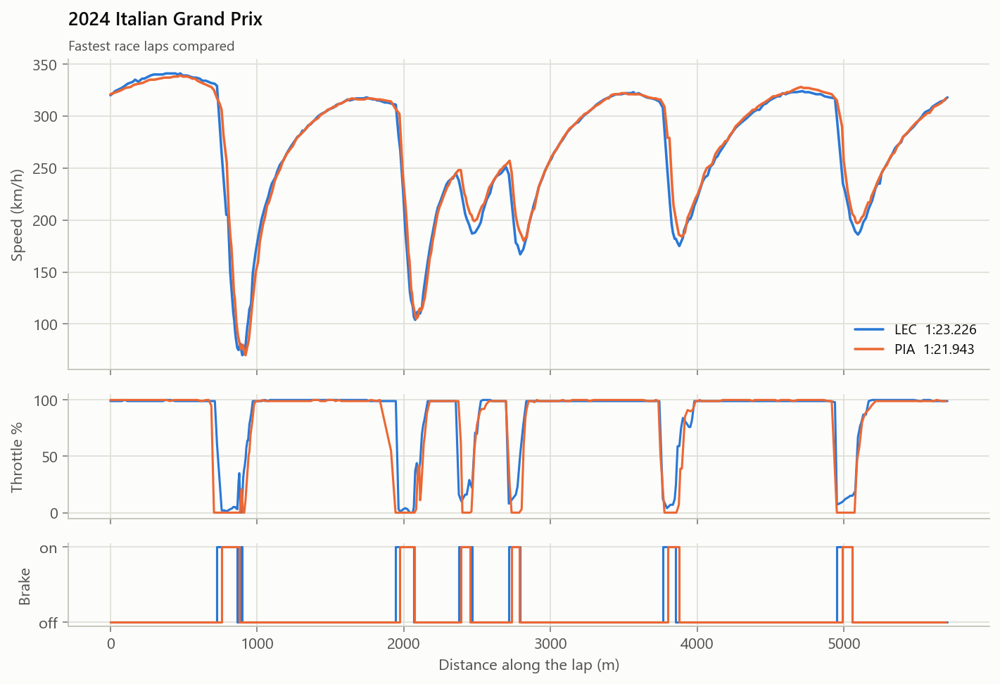
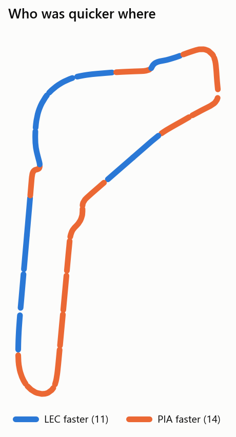

# F1 Tyre Strategy & Pace Analysis

[](https://github.com/manookello/f1-tyre-strategy-analysis/actions/workflows/ci.yml)


Every race lap of Formula 1's ground-effect era (**2022–2025: 92 Grands Prix, ~101,000 laps**)
used to answer strategy questions:
- How fast does each tyre compound degrade?
- What does a pit stop cost at each circuit?
- What drives a lap time?
- Given a race's tyre behaviour, **what was the optimal strategy**, and did the winner use it?



## Findings

**Tyres**
- **Degradation.** Median degradation, fuel-corrected and after removing driver pace and track
  evolution, is **62 ms per lap of tyre age for softs, 54 for mediums and 43 for hards**. The
  longest stints run are typically 25, 32 and 40 laps.
- **Per-race estimates are noisy.** Drivers manage their tyres, and the track keeps rubbering in
  (a median of about 28 ms per lap faster as a race goes on). The medians over 40–80 races are
  the robust numbers.
- **Track temperature barely matters.** It shows almost no correlation with degradation across
  races, because Pirelli's compound choice and the teams' set-ups absorb the effect.

**Pit stops**
- A green-flag stop costs a median of **22.9 s**, from 19.5 s to 29.9 s depending on the circuit.
  This is measured as the in-lap plus the out-lap, minus two normal laps.

<p align="center">
  
  
</p>

**Strategy**
- **Winners have shifted to one-stoppers:** 7 of 22 races in 2022 were won on one stop, against
  12 of 24 in 2025.
- **The simulator** enumerates every 1- and 2-stop plan using each race's fitted tyre model and
  measured pit loss. Over 77 dry races it **picks the winner's number of stops 66% of the time**.
  When it recommends a one-stop, the winner one-stopped in 32 of 46 races.
- **The misses are mostly extra stops.** In 23 of the 26 misses the winner stopped *more* often
  than the plan. That fits a cheap stop under a safety car or VSC, which 74 of the 77 races
  had at some point and which a pre-race plan can't foresee.



**Lap-time model.** The model predicts clean race laps in races it never saw, using grouped
5-fold cross-validation by race.

| Model | MAE per lap | Median error | R² |
|---|---|---|---|
| Race median lap (baseline) | 1.04 s | 0.83 s | 0.00 |
| Ridge (compound, tyre age, fuel, car, driver) | 0.72 s | 0.52 s | 0.38 |
| **LightGBM** (+ traffic, weather, circuit) | **0.70 s** | **0.48 s** | 0.38 |

- **Both models cut the error by about a third.** LightGBM only edges the linear model:
  once fuel, tyre age and the car are known, most effects simply add up.
- **Most important features:** race progress (fuel and tyres together), running position
  (traffic), the car, and the circuit and conditions.

**Telemetry.** Fastest race laps from OpenF1 car data, as speed/throttle/brake overlays and
mini-sector maps. Notebook 04 covers Monaco 2023, Monza 2024 and Silverstone 2025.

<p align="center">
  
  
</p>

## Data: two sources, one schema

| Seasons | Source | Notes |
|---|---|---|
| 2022 | [FastF1](https://docs.fastf1.dev), reading the official F1 live-timing archive | loaded with a paced, resumable downloader |
| 2023–2025 | [OpenF1](https://openf1.org) | the live-timing archive began returning **HTTP 401** to anonymous users while this project was being built (an F1 account is now required). OpenF1 serves the same timing data for every session since 2023, free and without authentication |

`f1tyres.openf1` converts OpenF1's laps, stints, pit stops, race-control messages and weather
into the exact columns FastF1 produces:
- the in-lap is the lap before a pit-out lap;
- the SC/VSC/red-flag status of each lap comes from race-control messages;
- running position comes from lap completion times;
- weather is joined to each lap by time.

Every analysis therefore treats all four seasons identically. Both loaders cache every request
and stay within the providers' rate limits.

## Method

- **Clean laps.** Keep dry-compound laps that are green-flag throughout, with no in/out laps, no
  lap 1 and no rain, and that are within 107% of the driver's stint median. That leaves 77% of
  all laps.
- **Fuel correction.** Each lap is expressed at the final-lap fuel load, assuming about 0.03 s
  per lap of fuel. This is a documented, configurable assumption.
- **Per-race tyre model.** A fixed-effects regression:
  `lap = driver effect + compound offset + compound slope × tyre age + β × lap number`.
  Driver effects absorb car and driver pace, and β absorbs track evolution. Compounds run by
  fewer than 3 drivers are not modelled, because their effect can't be separated from those
  drivers' pace. The fit recovers known parameters on synthetic data (see `tests/`).
- **Simulator.**
  - Race time is Σ(base + offset + slope × age) + stops × pit loss.
  - Rules: at least two dry compounds, no stint under 5 laps, and no stint longer than the
    longest run on that compound in that race.
- **Lap-time model.**
  - The target is the lap time relative to that race's median clean lap, so circuits are
    comparable.
  - The car is encoded as team × season.
  - Validation is grouped K-fold by race.

## Project structure

```
├── app/streamlit_app.py          # race strategy, degradation, interactive simulator, telemetry, model
├── data/processed/               # laps, stints, degradation, pit loss, strategy review, telemetry
├── models/laptime_model.joblib   # LightGBM lap-time model
├── notebooks/
│   ├── 01_data_collection.ipynb  # FastF1 + OpenF1 -> one schema
│   ├── 02_degradation.ipynb      # stints, tyre model, degradation, pit loss
│   ├── 03_lap_time_model.ipynb
│   ├── 04_telemetry.ipynb
│   └── 05_strategy_simulator.ipynb
├── reports/figures/
├── src/f1tyres/                  # data (FastF1), openf1, analysis, model, plots
└── tests/                        # tyre-model recovery, simulator rules, track status, app smoke test
```

## Quickstart

```bash
git clone https://github.com/manookello/f1-tyre-strategy-analysis.git
cd f1-tyre-strategy-analysis
python -m venv .venv && source .venv/bin/activate   # Windows: .venv\Scripts\activate
pip install -r requirements.txt -r requirements-dev.txt
pip install -e . --no-deps

streamlit run app/streamlit_app.py
pytest

# optional: rebuild the data
python -m f1tyres.openf1 --seasons 2023 2024 2025   # ~20 min (rate-limited, cached)
python -m f1tyres.data --seasons 2022                # needs F1_USERNAME / F1_PASSWORD now
python -m f1tyres.data --combine-only
```

## Limitations

- The simulator is a pre-race plan. It doesn't model safety cars, traffic, undercuts or tyre
  "cliffs", and its degradation is linear in tyre age.
- The 0.03 s/lap fuel effect is an assumption. Errors in it are partly absorbed by the
  track-evolution term.
- OpenF1 has no lap-accuracy flag like FastF1's, so equivalent filters are derived (pit, lap 1,
  green flag, 107% rule). One race, 2025 Miami, has incomplete lap coverage in OpenF1.

## Related projects

- [f1-race-outcome-predictor](https://github.com/manookello/f1-race-outcome-predictor): podium
  and finishing-order models for F1.
- [f1-vs-motogp-circuits](https://github.com/manookello/f1-vs-motogp-circuits): F1 vs MotoGP lap
  times at shared circuits, and which series is more competitive.
- [motogp-performance-analytics](https://github.com/manookello/motogp-performance-analytics):
  MotoGP eras, crashes and race-outcome models.

---

Timing data via FastF1 and OpenF1. This project is unofficial and not associated with Formula 1,
the FIA or Pirelli.
